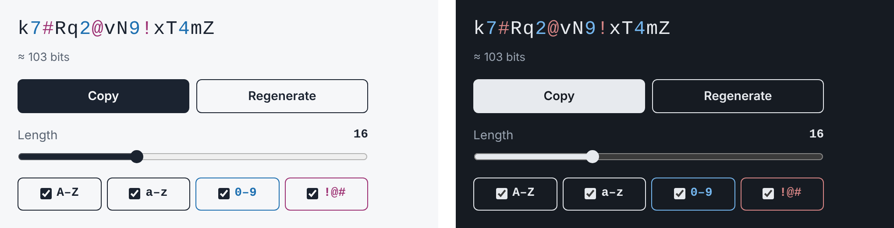

# Password Generator

[](https://github.com/juwelB/password-generator-extension/actions/workflows/ci.yml)

A Chrome and Edge extension that generates strong random passwords in one
click. It requests no permissions, stores nothing, and never touches the
network: passwords exist only in the popup and on your clipboard.



## Features

- A new password the moment the popup opens; copy it with one click
- Length from 8 to 32 characters, and any mix of uppercase, lowercase,
  digits, and symbols
- Every selected character type is guaranteed to appear
- Digits and symbols are color-coded, so look-alike characters such as `0`
  and `O` are easy to tell apart
- Strength shown as an entropy estimate in bits
- Follows the system's light or dark mode

## Security design

| Concern               | How it's handled                                                                                                                               |
| --------------------- | ---------------------------------------------------------------------------------------------------------------------------------------------- |
| Randomness            | `crypto.getRandomValues()`, the browser's cryptographically secure generator. `Math.random()` is never used.                                   |
| Modulo bias           | Rejection sampling: random values that would make some characters more likely than others are discarded and redrawn.                           |
| Predictable positions | The characters guaranteed for each selected type are shuffled into random positions with a Fisher-Yates shuffle, using the same secure source. |
| Data exposure         | Passwords are never stored, logged, or sent anywhere ([PWX-0002](docs/decisions/PWX-0002.md)).                                                 |
| Permissions           | The manifest requests none, so Chrome shows no warning at install.                                                                             |
| HTML injection        | Passwords are written to the page with `textContent`, never `innerHTML`, so characters like `<` and `>` are always shown as text.              |
| Supply chain          | Zero runtime dependencies; every package is a build or test tool.                                                                              |

## Architecture

The project follows a **functional core, imperative shell** design
([PWX-0003](docs/decisions/PWX-0003.md)):

- **`src/generator/generator.ts`** is pure logic: options in, password out.
  It never touches the page, clipboard, or storage. Its random source is
  passed in as a parameter, so tests can supply predictable values.
- **`src/popup/popup.ts`** is a thin UI layer with one-way data flow: every
  user action updates a single state object, then one `render()` function
  redraws the popup from it.

The full interface contract is in
[docs/design/generator-spec.md](docs/design/generator-spec.md).

## Testing

The generator was built test-first. Its 21 tests, written from
[the test plan](docs/design/test-plan.md), cover:

- **Boundaries:** the minimum, default, and maximum lengths
- **Property-based checks:** rules verified across thousands of generated
  passwords, such as "every selected type appears" and "no unselected
  characters appear"
- **Distribution:** each character appears about equally often across
  160,000 samples
- **Exact behavior with a fake random source:** including proof that
  rejection sampling discards biased values
- **Invalid input:** each case throws a typed error with a specific code

GitHub Actions runs formatting, linting, type checking, tests, and the build
on every push.

## Install from source

Requires Node.js 22 or later.

```bash
git clone https://github.com/juwelB/password-generator-extension.git
cd password-generator-extension
npm ci
npm run build
```

Then load it into the browser:

1. Open `chrome://extensions` (or `edge://extensions`).
2. Turn on **Developer mode**.
3. Click **Load unpacked** and select the `dist` folder.

## Development

| Command             | What it does                                      |
| ------------------- | ------------------------------------------------- |
| `npm test`          | Run the tests in watch mode                       |
| `npm run typecheck` | Check types with the TypeScript compiler          |
| `npm run lint`      | Lint with Oxlint                                  |
| `npm run format`    | Format all files with Prettier                    |
| `npm run build`     | Type-check, then build the extension into `dist/` |

To preview the popup in a normal browser tab, run `npx vite` and open
`http://localhost:5173/src/popup/popup.html`.

## Tech stack

TypeScript 7, Vite 8, Vitest, Oxlint, Prettier, GitHub Actions, Chrome
Manifest V3.

## Design decisions

Every significant choice is recorded as an Architecture Decision Record in
[docs/decisions](docs/decisions/README.md), including why the symbol set
changed twice and why the project uses Oxlint instead of ESLint.

## Roadmap

- An option to exclude look-alike characters (`0`/`O`, `1`/`l`/`I`)
- Remembering settings between uses
- Passphrase mode (random words instead of characters)
- A right-click menu to fill password fields directly
- End-to-end browser tests with Playwright
